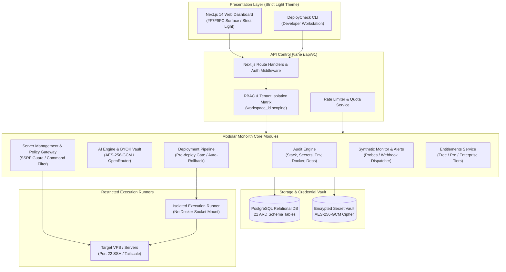

# DevSparks DeployCheck — Platform Architecture

> Comprehensive system architecture specification and design invariants for **DevSparks DeployCheck**.  
> Maintained by **DevSparks India**.

---

## 1. Architectural Philosophy

DevSparks DeployCheck is engineered as a secure, policy-controlled modular monolith designed for self-hosted deployment with cloud-ready multi-tenant isolation.

---

## 2. Core Architectural Invariants

### 2.1 Policy-Controlled AI Invariant
The platform is **never an unrestricted shell runner**. AI models (OpenRouter) are restricted to proposing structured diffs and diagnostic explanations. Every code modification and deployment action requires explicit, human approval via the side-by-side visual diff review modal.

$$\text{AI Proposes} \longrightarrow \text{Policy Gateway Validates} \longrightarrow \text{Human Approves} \longrightarrow \text{Restricted Runner Executes}$$

### 2.2 Strict Light Theme Design Invariant
In accordance with PRD Section 7 and ARD Section 4:
- The UI palette strictly enforces `#F7F9FC` background, `#FFFFFF` cards, `#172033` primary text, and `#3563E9` brand blue.
- Dark theme tokens, dark card surfaces, and dark toggles are strictly prohibited across all components and documentation screenshots.

### 2.3 BYOK Credential Vault (AES-256-GCM)
- AI provider API keys are encrypted at rest with authenticated AES-256-GCM cipher using a 256-bit derived key.
- Keys are masked (`sk-o••••••••tsrq`) for UI presentation.
- Decrypted keys are never returned in client payloads, API responses, error traces, or application logs.
- Private SSH keys are never transmitted to AI models.

### 2.4 SSRF & Network Boundary Protection
- Connection endpoints and webhook destinations are validated prior to socket creation via `SsrfGuard`.
- Cloud metadata endpoints (`169.254.169.254`, `metadata.google.internal`) and loopbacks (`127.0.0.0/8`, `localhost`) are blocked immediately.

---

## 3. Database Architecture (ARD Section 13)

The persistent storage layer is powered by PostgreSQL with 21 relational tables defined in `migrations/0001_initial_schema.sql`:

1. **Identity & Workspaces:** `users`, `sessions`, `workspaces`, `workspace_members`.
2. **Projects & Audits:** `projects`, `audit_rules`, `audit_runs`, `audit_findings`.
3. **AI & Remediation:** `ai_provider_connections`, `ai_conversations`, `ai_messages`, `ai_usage_events`.
4. **Operations & Events:** `jobs`, `audit_events`.
5. **Infrastructure & Servers:** `secret_store`, `servers`, `server_operations`.
6. **Deployments & Pipelines:** `deployments`.
7. **Monitoring & Incident Management:** `monitoring_checks`, `monitoring_results`, `incidents`.

Every query scopes records by `workspace_id` to maintain multi-tenant isolation.

---

## 4. Module Map

| Module Path | Core Purpose | Status |
| :--- | :--- | :--- |
| `src/modules/audit/` | Static analysis rule engine (stack, secrets, deps, docker, env) | Verified / Production |
| `src/modules/ai/` | BYOK AES-256-GCM encryption and OpenRouter adapter | Verified / Production |
| `src/modules/rbac/` | Multi-layer role permission matrix and tenant isolation | Verified / Production |
| `src/modules/server/` | SSRF guard and server policy command filter | Verified / Production |
| `src/modules/deployment/` | Pre-deploy audit gate, build steps, and automatic rollback | Verified / Production |
| `src/modules/monitoring/` | Synthetic health checks, probe tracker, and webhook notifier | Verified / Production |
| `src/modules/entitlements/` | Multi-tier plan gating (`free`, `pro`, `enterprise`) | Verified / Production |
| `src/db/` | PostgreSQL client repository and SQL migration runner | Verified / Production |
| `src/core/` | Structured logger with secret redaction and typed errors | Verified / Production |

---

## 5. Further Architectural Specifications

For exhaustive low-level specifications, see:
- [`docs/ARD.md`](docs/ARD.md) — Architectural Requirements Document (Complete Spec).
- [`docs/decisions/`](docs/decisions/) — Architectural Decision Records (ADRs 0001–0005).
- [`docs/api/openapi.yaml`](docs/api/openapi.yaml) — OpenAPI 3.1 REST Contract.
