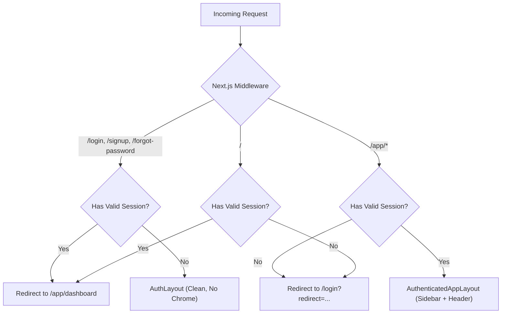

# DevSparks DeployCheck — Authentication & UI Architecture Audit

**Audit Timestamp:** 2026-11-05  
**Document Version:** 1.0.0  
**Authority:** ARD Section 13 & Security Architecture Review

---

## 1. Executive Summary

This audit evaluates the routing, authentication mechanisms, and UI component hierarchy of **DevSparks DeployCheck**. The investigation identified critical architectural gaps where authenticated operational dashboards were rendered unconditionally on the root route (`/`) without session enforcement, auth pages shared application chrome with privileged sidebars, and desktop controls permitted inadvertent sidebar collapse.

---

## 2. Codebase Diagnostic Findings

### Finding 1: Dashboard Loads Without Authentication (P0 Vulnerability)
- **Observed Behavior:** Navigating directly to `http://localhost:3000` or `/` immediately loads the Super Admin Operations Dashboard with full telemetry, project listings, and action buttons.
- **Root Cause:** `src/app/page.tsx` was structured as a monolithic Single Page Application (SPA) client component where `activeView` defaulted to `"dashboard"`. No Next.js middleware, server-side session check, or HTTP cookie validation existed on the root route or protected sub-routes.
- **Impact:** Complete authentication bypass allowing unauthenticated visitors to view workspace metadata, project names, and system operational statuses.

### Finding 2: Login and Signup Screens Display Authenticated Sidebar & Chrome (P0 Usability/Security Issue)
- **Observed Behavior:** Accessing the authentication view via the sidebar or navigating to `/login` embedded `<AuthView />` inside the persistent `<Sidebar>` and `<Header>` layout.
- **Root Cause:** In `src/app/page.tsx`, `activeView === "auth"` was rendered inside the same DOM tree as `<Sidebar>` and `<Header>`. Additionally, while `/login` and `/signup` routes existed in `src/app/login/page.tsx` and `src/app/signup/page.tsx`, their layout inherited root layout tokens without layout segmentation.
- **Impact:** Unauthenticated users on the login screen were exposed to administrative navigation options (VPS Servers, Deployments, RBAC, Billing).

### Finding 3: Missing and Inaccessible Signup & Recovery Flows (P0 Feature Gap)
- **Observed Behavior:** `/signup` merely re-rendered the identical prototype component as `/login`. No password strength indicators, terms acceptance, duplicate email handlers, or password recovery endpoints (`/forgot-password`, `/reset-password`) existed.
- **Root Cause:** Lack of dedicated auth sub-routes and absence of a server-side authentication API module.
- **Impact:** Inability for new developers to safely onboard, absence of account recovery, and lack of role containment.

### Finding 4: Insecure Prototype Form State (P0 Compliance Gap)
- **Observed Behavior:** `AuthView.tsx` hardcoded dummy credentials (`nikhil@devsparksindia.com`, `••••••••••••`) in client state and used a dummy `setTimeout` simulator rather than calling a cryptographic authentication backend.
- **Root Cause:** Legacy prototype code was left unlinked to the database layer (`src/db/schema.ts` and `src/db/client.ts`).
- **Impact:** Non-compliance with Rule 3 ("No Fabricated Data or Artificial Work").

### Finding 5: Desktop Sidebar Collapse Toggle Present (P1 UX Invariant)
- **Observed Behavior:** The sidebar rendered a collapse toggle button (`«` / `»`) on desktop displays, shrinking the sidebar into an icon-only strip and causing truncation of the brand title (`DevSparks DeployC...`).
- **Root Cause:** `Sidebar.tsx` and `Header.tsx` exposed desktop collapse toggles rather than restricting collapsible drawers exclusively to mobile viewports.
- **Impact:** Reduced navigation readability and cluttered desktop header.

---

## 3. Remediated Architecture Plan

### Route Segmentation Matrix

| Path Pattern | Classification | Layout Applied | Middleware Guard |
| :--- | :--- | :--- | :--- |
| `/login`, `/signup` | Public Auth | `AuthLayout` (No sidebar/header) | Redirect to `/app/dashboard` if already authenticated |
| `/forgot-password`, `/reset-password` | Public Auth | `AuthLayout` (No sidebar/header) | Open access with token verification |
| `/app/*` | Protected App | `AuthenticatedAppLayout` | Strict session cookie validation; 302 redirect to `/login` |
| `/api/v1/auth/*` | Public API | N/A (JSON) | Rate-limited endpoints for login, signup, recovery |
| `/api/v1/(audits, deploy, etc.)` | Protected API | N/A (JSON) | 401 Unauthorized if session token absent or invalid |

---

## 4. Security & Cryptographic Invariants

1. **Password Hashing:** Scrypt (`crypto.scryptSync`) with high-entropy salt and hex encoding (`scrypt:salt:hash`), with timing-safe comparison via `crypto.timingSafeEqual`.
2. **Session Security:** 32-byte cryptographically secure random session tokens (`crypto.randomBytes(32)`). Only the SHA-256 hash of the token is stored in the database (`token_hash`).
3. **Cookie Configuration:** `deploycheck_session` stored with `HttpOnly`, `SameSite=Lax`, `Path=/`, and `Secure` in production.
4. **Lowest Permitted Role Invariant:** All public registrations automatically receive role `DEVELOPER` or `VIEWER`. Administrative (`ADMIN`, `OWNER`) roles cannot be self-assigned under any circumstances.
5. **Rate Limiting:** IP-based and identifier-based rate limiting on `/api/v1/auth/login` and `/api/v1/auth/signup`.

