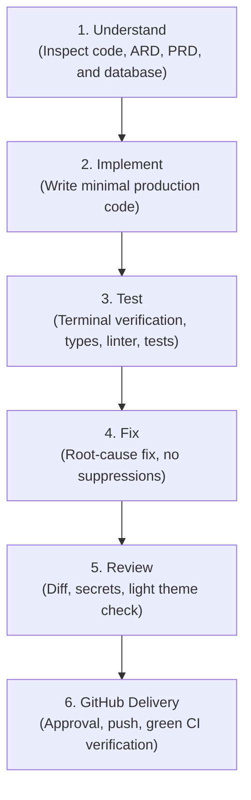

# DevSparks DeployCheck — Engineering Quality & Delivery Standards

This document establishes the permanent engineering, design, architecture, and verification standards for the **DevSparks DeployCheck** developer operations platform.

---

## 1. System Overview & Technology Stack

| Layer | Technology |
|---|---|
| **Frontend** | Next.js 14 (App Router) + React 18 + TypeScript |
| **Styling & Icons** | Tailwind CSS + Lucide React + Custom SVG Icons (`Icons.tsx`) |
| **Animations** | GSAP 3 + `@gsap/react` (with `prefers-reduced-motion` guards) |
| **Backend** | Node.js + Next.js Route Handlers + TypeScript |
| **Business Logic** | Pure JavaScript modules in `src/lib/` |
| **Database** | PostgreSQL with versioned schema migrations |
| **API Architecture** | RESTful `/api/v1` with structured envelopes and server-side RBAC |
| **Target Design System** | Strict Light Theme Only (`#F7F8FC`, `#FFFFFF`, `#172033`, `#5938F5`) |

---

## 2. Core Architectural Invariants

1. **Strict Light Theme Only:** Dark mode, dark surfaces, dark tokens, and theme toggle switches are permanently prohibited.
2. **Policy-Controlled AI Invariant:** No raw or unrestricted command execution by AI. AI models only propose structured JSON patches. Sensitive operations execute in isolated policy runners after explicit human approval.
3. **No Fabricated Work:** Real operational telemetry only. No fake CI graphs, empty commits, or simulated metrics.
4. **Credential Isolation:** Secrets encrypted at rest with AES-256-GCM. Decrypted secrets are never logged or sent to LLM providers.
5. **Zero-Failure CI Invariant:** All pushed code must have 100% green CI on GitHub Actions with 0 errors and 0 ESLint warnings.

---

## 3. Mandatory 6-Step Delivery Workflow



---

## 4. Verification Suite Commands

Every developer and agent must run and verify:

```bash
# 1. Type Safety Check
npm run typecheck

# 2. Strict Linting with Zero Warnings
npx eslint . --ext .ts,.tsx --max-warnings 0

# 3. Core MVP Platform Tests
node scripts/verify-mvp.mjs

# 4. Authentication & Security Flow Tests
node scripts/verify-auth.mjs

# 5. Pre-Deployment Static Audit Engine
node scripts/run-audit.mjs
```

---

## 5. Human Engineering Deliverable Requirements

Every feature submission must document:
- Requirements satisfied
- Files created and modified
- Test and verification evidence (exact exit codes, passing counts)
- Git commit hashes and branch status
- CI workflow health confirmation
