# DevSparks DeployCheck — Product Roadmap

> Release roadmap and implementation milestones for **DevSparks DeployCheck**.  
> Maintained by **DevSparks India**.

---

## 1. Executive Roadmap Overview

DevSparks DeployCheck follows a structured 7-milestone roadmap designed to establish a production-grade developer operations platform.

```mermaid
flowchart LR
    M0["M0: Foundation<br/>✅ Completed"] --> M1["M1: Audit Engine<br/>✅ Completed"]
    M1 --> M2["M2: BYOK AI Assist<br/>✅ Completed"]
    M2 --> M3["M3: Secure Servers<br/>✅ Completed"]
    M3 --> M4["M4: Deploy Pipeline<br/>✅ Completed"]
    M4 --> M5["M5: Monitoring<br/>✅ Completed"]
    M5 --> M6["M6: Entitlements<br/>✅ Completed"]
    M6 -.-> M7["M7: Multi-Region<br/>⏳ Planned"]
    M7 -.-> M8["M8: Cloud Plane<br/>⏳ Planned"]
```

---

## 2. Core Milestone Tracker

### Milestone M0: Repository Foundation & Governance (✅ Completed)
- [x] Initial repository structure and standards.
- [x] Strict Light Theme Only design system tokens (`#F7F9FC` background, `#FFFFFF` cards, `#3563E9` blue).
- [x] GitHub workflows (`ci.yml`, `security.yml`) with zero-failure CI rule.
- [x] Architectural Decision Records (ADRs 0001–0005).
- [x] Governance documents (`CONTRIBUTING.md`, `CODE_OF_CONDUCT.md`, `SECURITY.md`, `SUPPORT.md`, `LICENSE`).

### Milestone M1: Audit Engine MVP (✅ Completed)
- [x] Static analysis rule engine (`src/modules/audit/engine.ts`).
- [x] Stack detector (Next.js, Node.js, TypeScript, package manager).
- [x] Secret scanner for API keys, bearer tokens, and private keys.
- [x] Dockerfile and Docker Compose security checker.
- [x] Dependency version discrepancy scanner.
- [x] Environment variable checker.
- [x] Pre-deployment audit CLI runner (`scripts/run-audit.mjs`).

### Milestone M2: BYOK AI Assistance & Policy Governance (✅ Completed)
- [x] Authenticated AES-256-GCM encryption vault (`src/modules/ai/encryption.ts`).
- [x] OpenRouter provider adapter with token usage tracking.
- [x] Real-time Server-Sent Events (SSE) streaming chunk formatter.
- [x] Policy-Controlled AI Invariant (AI only proposes patches; human approval required).
- [x] Side-by-side visual diff review modal with approval state machine.

### Milestone M3: Secure Server & VPS Connections (✅ Completed)
- [x] Server connection and validation API (`/api/v1/servers/validate`).
- [x] SSRF guard blocking loopbacks and cloud metadata endpoints (`169.254.169.254`).
- [x] Policy gateway command filter prohibiting destructive shell commands (`rm -rf /`).
- [x] SSH host-key fingerprint verification.

### Milestone M4: Guided Policy-Controlled Deployment (✅ Completed)
- [x] Pre-deploy audit gating (audits must pass before deployment initiates).
- [x] Sequential deployment pipeline state machine (`QUEUED` ➔ `AUDITING` ➔ `BUILDING` ➔ `DEPLOYING` ➔ `VERIFYING` ➔ `SUCCESS`).
- [x] Automatic deployment rollback upon post-deployment probe failure.

### Milestone M5: Synthetic Monitoring & Health Probes (✅ Completed)
- [x] Synthetic health probe tracker (HTTP, TCP, TLS checks).
- [x] Consecutive failure threshold state transitions (`HEALTHY` ➔ `DEGRADED` ➔ `DOWN`).
- [x] Real-time p95 latency and uptime percentage calculation.
- [x] Outgoing webhook notification dispatcher supporting Slack, Discord, and Generic webhooks with HMAC signatures.

### Milestone M6: Multi-Tier Workspace Plans & Entitlements (✅ Completed)
- [x] Multi-tier plan definitions (`free`, `pro`, `enterprise`, `self_hosted_standard`).
- [x] Server and synthetic monitor quota gating.
- [x] Feature-flag entitlement evaluator (`/api/v1/workspaces/plan`).
- [x] PostgreSQL migration schema with 21 relational tables (`migrations/0001_initial_schema.sql`).

---

## 3. Post-MVP Planned Horizons

### Milestone M7: Advanced Cloud Registries & Container Scanning (⏳ Planned)
- [ ] Container image vulnerability scanner (Trivy / Grype integration).
- [ ] Automated Software Bill of Materials (SBOM) generation.
- [ ] Private registry credentials vault.

### Milestone M8: Multi-Region Distributed Health Probes (⏳ Planned)
- [ ] Geographically distributed synthetic probe runners (US, EU, APAC).
- [ ] TLS certificate expiration warnings (30/14/7 days).
- [ ] Public status page generator.

### Milestone M9: DevSparks Cloud Managed Control Plane (⏳ Planned)
- [ ] Managed multi-tenant cloud hosting option.
- [ ] One-click GitHub App repository integration.
- [ ] Team role-based billing and invoices.

