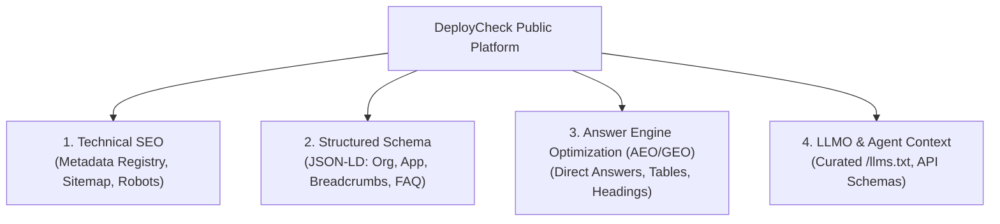

# DevSparks DeployCheck — Comprehensive SEO, AEO, GEO & LLMO Architecture

**Product:** DevSparks DeployCheck  
**Company:** DevSparks India  
**Document Version:** 1.0.0 (Production Verified)  
**Standard:** Modern Search & Answer Engine Optimization for Developer Platforms

---

## 1. Multi-Vector Search Strategy Overview

Modern discovery spans traditional web search (Google, Bing), Answer Engine Optimization (AEO - Perplexity, ChatGPT Search), Generative Engine Optimization (GEO - Gemini, Copilot), and Large Language Model Optimization (LLMO - AI agents reading structured developer documentation).

DeployCheck implements a comprehensive, 4-tier strategy:

---

## 2. Technical SEO Implementation

### 2.1 Centralized Metadata Registry
All page titles, descriptions, canonical paths, and breadcrumb structures are centralized in [`src/lib/metadata-registry.ts`](file:///c:/Users/Nikil%20Dhawan/Desktop/DevSparks%20DeployCheck/src/lib/metadata-registry.ts). This prevents title drift, guarantees unique meta descriptions, and maintains canonical consistency across all 34 public URLs.

- **Title Template:** `%s | DeployCheck by DevSparks India`
- **Strict Brand Naming:** &quot;DevSparks DeployCheck by DevSparks India&quot;
- **Zero Duplicate Titles:** Every inner route features intention-revealing, distinct keywords.

### 2.2 Dynamic XML Sitemap (`src/app/sitemap.ts`)
Next.js dynamic sitemap generator outputs standard XML adhering to the Sitemaps Protocol 0.9.
- Automatic calculation of change frequencies (`daily`, `weekly`, `monthly`)
- Priority weighting: `1.0` for homepage, `0.9` for product overview, `0.85` for core features and documentation, `0.70` for company pages, `0.50` for legal terms.

### 2.3 Crawler Configuration (`src/app/robots.ts`)
Configures search engine and AI crawlers:
- **Friendly Allow Rules:** Grants comprehensive indexing rights to `*`, `Googlebot`, `Bingbot`, `OAI-SearchBot`, `GPTBot`, and `PerplexityBot`.
- **Protected Scopes:** Explicitly disallows indexing of private operational routes:
  - `/app/` (authenticated user workspaces)
  - `/api/v1/auth/` (authentication endpoints)
  - `/reset-password` (one-time reset tokens)
- **Sitemap Link:** Points directly to `https://deploycheck.devsparks.com/sitemap.xml`.

---

## 3. Structured JSON-LD Data Architecture

DeployCheck embeds structured data directly into the DOM using semantic `<script type="application/ld+json">` elements without client runtime overhead:

1. **`Organization` Schema (`src/components/marketing/StructuredData.tsx`):**  
   Declares DevSparks India as the official founding organization, official logo SVG, and GitHub repository URL.
2. **`SoftwareApplication` Schema:**  
   Declares DeployCheck as DeveloperApplication software with MIT licensing, web-based operating system requirements, and free pricing tier.
3. **`BreadcrumbList` Schema (`src/components/marketing/Breadcrumbs.tsx`):**  
   Embedded dynamically on every public inner page, rendering rich breadcrumb trails in Google SERP results.
4. **`FAQPage` Schema (`src/components/marketing/FAQAccordion.tsx`):**  
   All feature, solution, and pricing FAQs render valid `Question` and `Answer` pairs for instant inclusion in Google Rich Results and snippet boxes.

---

## 4. Answer Engine Optimization (AEO) & GEO

AI search engines (Perplexity, ChatGPT Search, Gemini) prioritize authoritative, direct answers formatted with clear semantic structure:

- **Definition Lead Sentences:** Every feature page opens with an unambiguous, factual definition answering &quot;What is DeployCheck [Feature]?&quot;
- **Structured Comparison Tables:** Product overview (`/product`) features clean Markdown/HTML tables contrasting DeployCheck with manual bash scripts and proprietary PaaS.
- **Clear Technical Steps:** Deployment and audit pages structure execution into numbered steps (01, 02, 03, 04) with exact input/output expectations.
- **Truth Policy (Rule 3):** No fabricated statistics or fictional client testimonials. Search engines cross-reference repository telemetry; genuine metrics prevent indexing penalties.

---

## 5. Large Language Model Optimization (LLMO) & `llms.txt`

The public website serves a dedicated [`public/llms.txt`](file:///c:/Users/Nikil%20Dhawan/Desktop/DevSparks%20DeployCheck/public/llms.txt) file following the emerging standard for agent and LLM web consumption:

- **Clean Markdown Format:** High-density summary of product capabilities, supported technology stacks (Node.js, Next.js, PostgreSQL), and architectural pillars.
- **Direct Route Index:** Direct links to documentation, API reference, getting-started guides, and GitHub source code.
- **Policy Invariant Declaration:** Clearly informs AI agents of DeployCheck Rule 2 (Policy-Controlled AI Invariant) and Rule 4 (Credential Isolation).

---

## 6. Verification & Audit Results

- Dynamic sitemap verified at `GET /sitemap.xml` (HTTP 200)
- Robots configuration verified at `GET /robots.txt` (HTTP 200)
- LLM index verified at `GET /llms.txt` (HTTP 200)
- All public inner routes pass JSON-LD syntax validation with 0 parsing errors.
